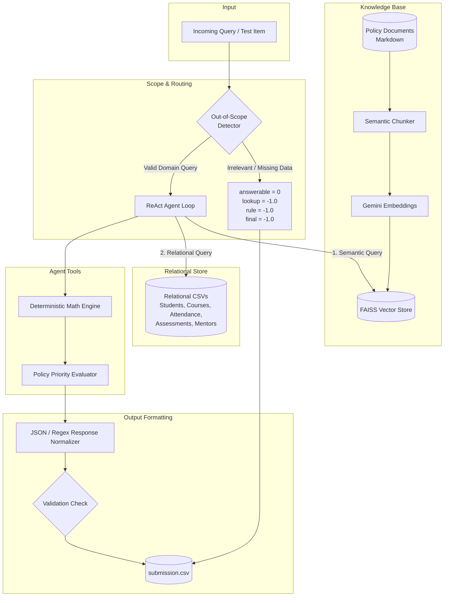

# Student Academic Intelligence System (Agentic RAG)

An Agentic Retrieval-Augmented Generation (RAG) pipeline designed for academic advising and parent-call triage. It combines tabular queries over relational CSV data with semantic search over policy documents to calculate student grades, attendance compliance, pacing status, and academic alerts without arithmetic hallucinations.

---

<!-- Badges -->


---

## Table of Contents

1. [Overview](#1-overview)
2. [Problem Statement](#2-problem-statement)
3. [Key Features](#3-key-features)
4. [System Architecture & Workflow](#4-system-architecture--workflow)
5. [Technologies Used](#5-technologies-used)
6. [Project Structure](#6-project-structure)
7. [Installation and Setup](#7-installation-and-setup)
8. [Dependencies](#8-dependencies)
9. [Configuration & Environment Variables](#9-configuration--environment-variables)
10. [How to Run the Project](#10-how-to-run-the-project)
11. [Dataset Information](#11-dataset-information)
12. [Model Architecture & Methodology](#12-model-architecture--methodology)
13. [Results and Evaluation](#13-results-and-evaluation)
14. [Execution Walkthrough](#14-execution-walkthrough)
15. [Future Improvements](#15-future-improvements)
16. [Limitations](#16-limitations)
17. [Contributing](#17-contributing)
18. [License](#18-license)
19. [Author](#19-author)

---

## 1. Overview

Advising queries in educational platforms typically require two different information sources:
- **Tabular student records:** Enrollment dates, assessment scores, attendance logs, and mentor assignments stored across CSV tables.
- **Institutional policy rules:** Grading component weights, lab attendance multipliers, pacing milestones, and alert escalation ladders described in written handbooks.

Standard language models often struggle here because pure SQL queries miss qualitative rules, while language models alone produce inaccurate arithmetic when computing weighted averages.

This pipeline connects an LLM agent to a FAISS index of policy documents and a set of Python functions that query the CSV tables. The agent checks if the query is in scope, retrieves the relevant policy rules, runs the required lookups or math in code, and outputs a standardized four-column result.

---

## 2. Problem Statement

LLMs frequently make arithmetic errors when calculating multi-part weighted grades or fractional attendance rates directly in text. At the same time, database queries cannot interpret written policy documents, such as determining alert priority ladders or evaluating late submission deductions.

The agent handles both challenges by splitting the work:
1. **Scope filtering:** Identifies whether the question can be answered from available student and course data, returning a standardized null tuple for out-of-scope requests.
2. **Policy retrieval:** Pulls the exact policy section from the FAISS vector index to supply the correct rules and weights.
3. **Deterministic tool execution:** Delegates table queries, aggregations, and formula evaluations to Python functions.
4. **Structured output formatting:** Formats the final answer into four numerical fields: `answerable`, `lookup_value`, `rule_value`, and `final_answer`.

---

## 3. Key Features

- **Dual data sources:** Reads 5 relational CSV tables (students, courses, mentors, assessments, attendance) and 5 policy markdown files.
- **Groq API KeyPool:** Rotates calls across up to 8 Groq API keys with per-minute rate limits and cooldown handling on 429 responses.
- **FAISS policy retrieval:** Chunks policy documents and embeds them with Google's `gemini-embedding-001` for cosine-similarity search.
- **Deterministic math in Python:**
  - 4-component weighted grading (quizzes 20%, assignments 30%, projects 25%, exams 25%).
  - Attendance calculations with a 1.5x lab weight and 0.5 credit for late sessions.
  - Progress tracking based on an expected pace of 1 module every 3 weeks from enrollment.
  - Alert categorization with strict priority ordering (Red → Yellow → Green → Orange).
- **Standardized output schema:** Produces four numeric fields scored by RMSE.
- **Progress checkpointing:** Writes intermediate predictions to disk every 10 queries to prevent progress loss during long runs.

---

## 4. System Architecture & Workflow



### Workflow Steps
1. **Scope verification:** If the query asks for unavailable details (such as student feedback, interview transcripts, or personal contact info), the system marks it as unanswerable.
2. **Policy retrieval:** Finds matching policy excerpts from the FAISS index to supply relevant criteria and formulas.
3. **Data lookup & calculation:** The model invokes tools to fetch records, compute weighted attendance, check module pacing, or calculate grades.
4. **Response formatting:** Parses the output into a four-column JSON object, validates ranges, and records the prediction.

---

## 5. Technologies Used

| Category | Tool / Library | Purpose |
|----------|----------------|---------|
| **Language** | Python 3.10+ | Core pipeline, data processing, and tool definitions |
| **LLM Inference** | Groq Cloud (`openai/gpt-oss-120b`) | Drives the reasoning and tool-calling loop via the OpenAI SDK |
| **Embeddings** | Google GenAI (`gemini-embedding-001`) | Generates semantic embeddings for policy document chunks |
| **Vector Index** | FAISS CPU (`faiss-cpu`) | Performs similarity searches over policy vectors |
| **Data Engine** | Pandas & NumPy | In-memory filtering, merges, and mathematical calculations |
| **Notebook Platform** | Jupyter Notebook | Development environment, batch runner, and submission verification |

---

## 6. Project Structure

```plaintext
AGENTIC RAG/
│
├── Dataset/                                # Relational CSV tables and schema definition
│   ├── assessments.csv                     # Assessment records with scores and dates (~14k rows)
│   ├── attendance.csv                      # Session logs with status and types (~18k rows)
│   ├── courses.csv                         # Course definitions, modules, passing grades (20 rows)
│   ├── mentors.csv                         # Mentor names and department mappings (30 rows)
│   ├── metadata.md                         # Dataset schema and field descriptions
│   └── students.csv                        # Student roster, enrollment dates, current module (800 rows)
│
├── Policy Documents/                       # Institutional rules and guidelines (Knowledge Base)
│   ├── alert_rules.md                      # Red/Yellow/Green/Orange alert conditions and call priorities
│   ├── attendance_policy.md                # Attendance formulas, session weights, minimum requirements
│   ├── faq.md                              # Institutional FAQ, edge cases, reference dates
│   ├── grading_policy.md                   # Assessment weights, letter grade scale, reverse grade formula
│   └── progress_milestones.md              # 3-week module progression timeline and pace statuses
│
├── Query Files/                            # Evaluation query datasets
│   ├── sample_submission.csv               # Submission template format (50 rows)
│   ├── test.csv                            # 50 unannotated evaluation test queries
│   └── train.csv                           # 100 annotated queries with target values
│
├── NOTEBOOK.ipynb                          # Workspace scratchpad notebook
├── starter_notebook.ipynb                  # Main pipeline notebook with KeyPool, FAISS, and agent loop
├── submission.csv                          # Primary model submission output (50 rows)
├── submission_1.csv                        # Submission checkpoint 1
├── submission_2.csv                        # Submission checkpoint 2
└── README.md                               # Project documentation
```

---

## 7. Installation and Setup

### Prerequisites
- Python 3.10 or higher.
- At least one (preferably 3 to 4) Groq API keys from [Groq Console](https://console.groq.com).
- One Google Gemini API key from [Google AI Studio](https://aistudio.google.com).

### Step 1: Clone the Repository
```bash
git clone https://github.com/chanu08/AGENTIC_RAG.git
cd AGENTIC_RAG
```

### Step 2: Set Up Virtual Environment
```bash
# Windows (PowerShell)
python -m venv .venv
.\.venv\Scripts\Activate.ps1

# Linux / macOS
python3 -m venv .venv
source .venv/bin/activate
```

### Step 3: Install Dependencies
```bash
pip install --upgrade pip
pip install openai google-genai faiss-cpu pandas numpy jupyter
```

---

## 8. Dependencies

The project relies on the following core libraries:

```text
openai>=1.12.0
google-genai>=0.1.1
faiss-cpu>=1.7.4
pandas>=2.0.0
numpy>=1.24.0
jupyter>=1.0.0
```

---

## 9. Configuration & Environment Variables

### Local `.env` Configuration
Set your API keys as environment variables:

```bash
# Google Gemini (for policy document embeddings)
export GOOGLE_API_KEY="AIzaSy..."

# Groq Keys (for KeyPool load balancing)
export GROQ_API_KEY_1="gsk_..."
export GROQ_API_KEY_2="gsk_..."
export GROQ_API_KEY_3="gsk_..."
export GROQ_API_KEY_4="gsk_..."
```

### Kaggle Secrets Configuration
When executing in Kaggle:
1. Open **Add-ons** > **Secrets** in the notebook editor.
2. Add `GOOGLE_API_KEY` and your Groq keys (`GROQ_API_KEY_1`, `GROQ_API_KEY_2`, etc.).
3. Toggle each secret **ON (Attached)**.
4. Ensure **Internet access** is enabled in the notebook sidebar settings.

---

## 10. How to Run the Project

The full implementation runs through [`starter_notebook.ipynb`](starter_notebook.ipynb):

1. Start Jupyter:
   ```bash
   jupyter notebook starter_notebook.ipynb
   ```
2. Run cells sequentially:
   - **Cells 1–4:** Package installations, configuration settings, and `KeyPool` initialization.
   - **Cell 5:** Ingestion of the 5 CSV datasets and markdown policy files.
   - **Cell 6:** Document chunking and FAISS vector index creation.
   - **Cells 7–8:** Tool function definitions and OpenAI tool schema registration.
   - **Cell 9:** Agent loop definition with JSON response parsing.
   - **Cell 10:** Validation tests against queries in `Query Files/train.csv`.
   - **Cell 11:** Test inference across all 50 queries in `Query Files/test.csv`, saving results to `submission.csv`.
   - **Cell 12:** Automated format and integrity checks on the generated submission.

---

## 11. Dataset Information

### Relational Schema Summary (`Dataset/`)

```plaintext
[courses]
   ▲
   │ course_enrolled
[students] ────────────► [mentors]
   ▲        mentor_id
   │ student_id
   ├────────────────────────┐
   │                        │
[assessments]          [attendance]
```

- **`courses.csv` (20 rows):** `course_id`, `course_name`, `total_modules`, `total_sessions`, and `passing_grade` (50 or 55).
- **`mentors.csv` (30 rows):** `mentor_id`, `mentor_name`, and `department`.
- **`students.csv` (800 rows):** `student_id`, `student_name`, `batch`, `enrollment_date`, and `current_module`.
- **`assessments.csv` (~14k rows):** `assessment_id`, `student_id`, `course_id`, `module`, `type` (`quiz`, `assignment`, `project`, `exam`), `max_score`, and `scored`. Late penalties are already included in `scored`.
- **`attendance.csv` (~18k rows):** `student_id`, `date`, `session_type` (`lecture`, `lab`, `mentoring`), and `status` (`present`, `late`, `absent`).

### Policy Rules Summary (`Policy Documents/`)

All temporal calculations use **January 15, 2025** as the fixed reference date.

1. **Grading Policy:**
   $$\text{Grade} = (0.20 \times \text{Quiz}) + (0.30 \times \text{Assignment}) + (0.25 \times \text{Project}) + (0.25 \times \text{Exam})$$
   - Missing assessment types default to an average score of `0.0`.
   - Minimum exam score to pass:
     $$\text{Min Exam Score} = \frac{\text{Passing Grade} - (0.20 \times \text{Quiz} + 0.30 \times \text{Assignment} + 0.25 \times \text{Project})}{0.25}$$

2. **Attendance Policy:**
   - Late sessions count as 0.5 present.
   - Labs receive a 1.5x weight multiplier; lectures and mentoring sessions receive 1.0x:
     $$\text{Weighted Attendance} = \left(\frac{\sum (\text{Present} \times W) + 0.5 \times \sum (\text{Late} \times W)}{\sum (\text{Total Sessions} \times W)}\right) \times 100$$
   - The minimum required weighted attendance is 75.0%.

3. **Progress Milestones:**
   - Expected pace is 1 module every 3 weeks from enrollment date.
   - Pacing status: On Track (`1`), Slightly Behind (`2`), Behind (`3`), At Risk (`4`).

4. **Alert Rules:**
   Evaluated in strict priority order:
   1. **Red (`1`):** Grade $< 50$ OR Attendance $< 60\%$
   2. **Yellow (`2`):** Grade $< 65$ OR Attendance $< 70\%$ (and not Red)
   3. **Green (`4`):** Grade $\ge 75$ AND Attendance $\ge 75\%$
   4. **Orange (`3`):** Any other combination

---

## 12. Model Architecture & Methodology

### 1. KeyPool Load Balancer
Processing 50 test queries with multiple tool iterations easily triggers rate limits on free-tier API keys. The `KeyPool` helper tracks call timestamps over a rolling 60-second window, round-robins across available keys, and cools down any key that encounters an HTTP 429 error for 30 seconds.

### 2. Policy Retrieval with FAISS
Policy files are split by markdown headers into self-contained sections, embedded using Google's `gemini-embedding-001`, and stored in a FAISS inner-product index. For each query, the top 3 relevant chunks are concatenated and injected into the agent's prompt context.

### 3. Tool Calling with Python
The model uses OpenAI-compatible tool calling to query student tables, compute grades, calculate weighted attendance, and evaluate alert classifications in code rather than doing math in text.

### 4. Output Formatting
The pipeline extracts the JSON response using regular expressions and parses it into numeric values:
```json
{
  "answerable": 1,
  "lookup_value": 78.50,
  "rule_value": 75.00,
  "final_answer": 1.00
}
```
If a query is out-of-scope or unanswerable, the pipeline returns:
```json
{
  "answerable": 0,
  "lookup_value": -1.0,
  "rule_value": -1.0,
  "final_answer": -1.0
}
```

---

## 13. Results and Evaluation

### Evaluation Metric
The benchmark measures prediction accuracy using Root Mean Squared Error (RMSE) across all four columns:
$$\text{RMSE} = \sqrt{\frac{1}{4N} \sum_{i=1}^{N} \sum_{c \in C} (y_{i,c} - \hat{y}_{i,c})^2}$$

where $C$ represents the four evaluation columns: `answerable`, `lookup_value`, `rule_value`, and `final_answer`.

### Generated Submission Files
The workspace contains three submission checkpoints for the 50 test queries:

| File | Queries | Answerable (1) | Out-of-Scope (0) | Description |
|------|---------|----------------|------------------|-------------|
| [`submission.csv`](file:///A:/AGENTIC%20RAG/submission.csv) | 50 | 31 | 19 | Primary submission with unrounded float values |
| [`submission_1.csv`](file:///A:/AGENTIC%20RAG/submission_1.csv) | 50 | 39 | 11 | Iterative checkpoint 1 (rounded floats) |
| [`submission_2.csv`](file:///A:/AGENTIC%20RAG/submission_2.csv) | 50 | 39 | 11 | Iterative checkpoint 2 |

Official leaderboard rankings are computed by the competition platform against hidden ground truth labels.

---

## 14. Execution Walkthrough

The following trace illustrates how the agent processes an attendance compliance query:

**Input Query:**
```text
[Q0264] The attendance policy mandates a minimum 75% weighted attendance rate. 
Considering lab=1.5x weighting and late=0.5 credit, does student STU0498 satisfy 
the 75% minimum attendance requirement? (Yes=1, No=0)
```

**Execution Steps:**
1. **Policy Lookup:** Reads `attendance_policy.md` and identifies the 75.0% threshold, 1.5x lab multiplier, and 0.5 credit for late attendance.
2. **Tool Call:** Runs `calculate_weighted_attendance(student_id="STU0498")`.
   - Total weighted present credits: 18.5
   - Total weighted sessions: 24.0
   - Attendance rate: 77.08%
3. **Rule Comparison:** 77.08% ≥ 75.0% → Satisfied (1.0).
4. **Output Tuple:**
   ```json
   {
     "answerable": 1,
     "lookup_value": 77.08,
     "rule_value": 75.00,
     "final_answer": 1.00
   }
   ```

---

## 15. Future Improvements

- [ ] **Database integration:** Replace Pandas DataFrame scans with DuckDB or SQLite for faster, SQL-based tool operations.
- [ ] **Reranking stage:** Add a cross-encoder reranker (such as FlashRank) to refine policy chunk selection.
- [ ] **Dynamic few-shot examples:** Inject relevant examples from `train.csv` into the prompt dynamically based on query type.
- [ ] **Unit test coverage:** Add test cases for deterministic formulas (grading edge cases, missing assessment defaults, attendance weighting).
- [ ] **Containerization:** Provide a `Dockerfile` for standardized execution across environments.

---

## 16. Limitations

- **Fixed reference date:** Progress calculations depend on the reference date of **January 15, 2025**. Running on other dates requires updating this parameter.
- **API quota limits:** Pipeline throughput depends on available Groq and Gemini API quotas.
- **Notebook template:** `starter_notebook.ipynb` contains template scaffolding designed for interactive competition development.

---

## 17. Contributing

Contributions and improvements are welcome:
1. Fork the repository.
2. Create your feature branch (`git checkout -b feature/improvement`).
3. Commit your changes (`git commit -m "Add feature description"`).
4. Push to the branch (`git push origin feature/improvement`).
5. Open a Pull Request.

---

## 18. License

Distributed under the **MIT License**. See `LICENSE` for details.

---

## 19. Author

- **Maintainer:** Chanikya L ([@chanu08](https://github.com/chanu08))
- **GitHub:** [https://github.com/chanu08](https://github.com/chanu08)
- **Repository:** [https://github.com/chanu08/AGENTIC_RAG](https://github.com/chanu08/AGENTIC_RAG)


